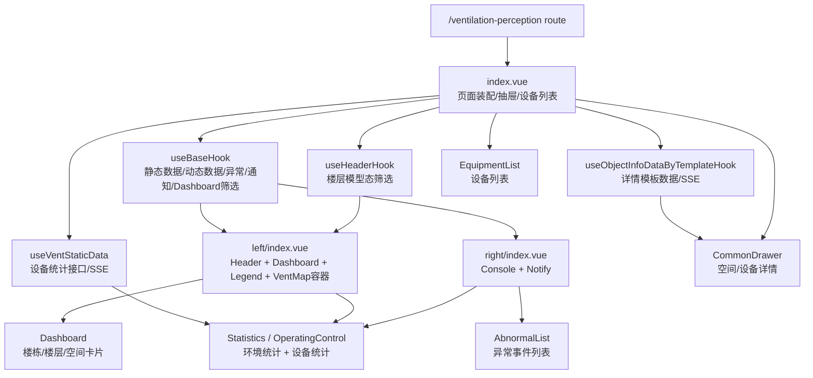
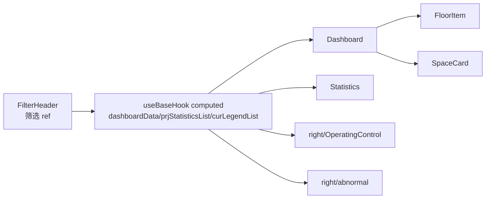
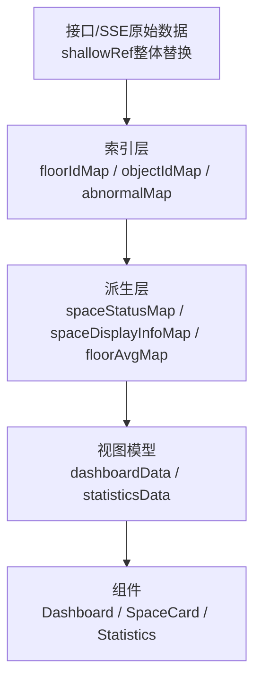

# VentPerceptionUpgraded 非 3D 页面数据流与性能分析

## 范围

本文分析 `src/views/VentPerceptionUpgraded/` 路由下的非 3D 页面数据流与性能风险。`left/vent-map/**`、`BuildingFloorScene.js`、`graph/**` 等 3D/地图渲染内部实现不展开，只说明列表态、右侧面板、筛选、抽屉、设备列表与模型态切换之间的数据关系。

路由入口在 `src/router/routes.js`，`/ventilation-perception` 进入前先加载 `src/views/VentPerceptionUpgraded/variables.js` 作为菜单配置，再渲染 `src/views/VentPerceptionUpgraded/index.vue`。

## 总体结论

该页面的核心架构是“路由根组件初始化多个 hooks，并通过 provide/inject 向左右面板分发共享状态”。其中：

- `useBaseHook` 是主数据中枢，负责静态空间/设备、动态 IoT 点位、异常事件、通知、筛选状态、Dashboard 数据、统计数据、抽屉状态等。
- `useHeaderHook` 是楼层模型态 Header 的筛选状态中枢，负责可控设备、设备类型、空间类型、环境参数等模型态筛选条件。
- `useVentStaticData` 独立负责通风设备统计接口和设备统计 SSE。
- `useObjectInfoDataByTemplateHook` 负责对象详情抽屉的 `DETAIL` 模板数据和详情 SSE。
- 左侧列表态与右侧控制台复用同一批 computed 数据，页面数据一致性较好，但也导致筛选、SSE、IoT 数据变化时容易触发多处全量重算。

## 组件职责图

## 页面初始化数据流

### 1. 路由与根组件

`src/views/VentPerceptionUpgraded/index.vue` 是页面装配层：

- 使用 `ExpansionCollapseNew` 放置左侧 `Left` 和右侧 `Right`。
- 调用 `useHeaderHook()` 初始化模型态筛选状态。
- 调用 `useBaseHook()` 初始化页面主状态，并接收 `loading`、`dyncDataLoading`、`selectObject`、`showCommonDrawer`、`curEquiList`、`currentFloorObj` 等。
- 调用 `useEquipmentList()` 管理设备列表浮层。
- 调用 `useObjectInfoDataByTemplateHook(selectObject)` 管理对象详情数据。
- 调用 `useVentStaticData(curEquiList)` 管理当前楼层或全项目设备统计。

入口处还有三个关键 watcher：

- `headerModelView === 'model'` 时调用展开收起组件的 `toggleWidth(true)`。
- `templateData` 变化且处于模型态时，从关系数据里提取关联对象并调用地图 ref 的 `showMapRelationMode`。
- `showCommonDrawer` 关闭时释放详情 SSE。

### 2. 静态空间/设备数据

`useBaseHook` 初始化后立即执行 `queryStaticDatas()`：

1. 调用 `listDashboardSpaces(RUNNING_MONITOR_TYPE, params)` 获取通风相关空间，以及空间关联设备。
2. 遍历返回数据，拆出：
   - `allSpaceList`：全量空间。
   - `allEquipList`：去重后的全量设备。
   - `floorIdMapSpaces`：楼层到空间列表映射。
   - `floorIdMapEquips`：楼层到设备列表映射。
   - `relFloorIdList`：涉及楼层列表。
   - `ventRoomFuncTypeMap`：通风涉及的空间功能类型映射。
   - `spaceClassCodeMap/equipClassCodeMap`：用于 Dashboard SSE 订阅的 classCode 到对象 ID 映射。
3. 调用 `setDashboardSSEClientOption(...)` 建立 Dashboard SSE 订阅。
4. 调用 `queryDashboardDyncDatas([...idSet])` 拉取动态点位。
5. 设置 `abnormalIds` 并调用 `onQueryAbnormalEventList(...)` 拉取/订阅异常事件。

接口定义在 `src/apis/ventilationPerception.js`：

- `listDashboardSpaces`: `/instance/listDashboardSpaces/{runningMonitorType}`
- `queryStatics`: `/ventilation/equipment/statistics`

### 3. 动态 IoT 点位

`queryDashboardDyncDatas(objectIds)` 通过 `loadDynaDataWithIotHandling` 调用 `listInfoCodeConfigsByObjectIdCommon`，模板类型为 `GRID`。返回后由 `dealDyncData(res)` 处理：

- 从每个空间的 `spaceGrid` 配置里提取存在 IoT 规则的环境点位，生成 `dashboardEnvTabs`。
- 生成 `spaceIdMapIotInfos`，记录每个空间在各环境参数下是否存在 IoT 规则。
- Dashboard SSE 由 `useDashboardSSE` 处理 `IOT_DATA_CHANGE`、`CLOUD_IOT_DATA_CHANGE`、`ABNORMAL_EVENT`，并交给 `responsiveDock` 更新全局对象数据缓存。

后续列表卡片、统计卡片并不直接持有动态数据，而是通过 `DockSingleton.getInstance().getIotData(id, infoCode)` 读取最新值。

## 列表态数据流

列表态由 `left/index.vue` 在 `headerModelView === 'list'` 时展示。核心链路是：

### 筛选来源

`FilterHeader.vue` 直接通过 inject 写入 `useBaseHook` 中的筛选 ref：

- `curDashboardOnlyIotCheck`：仅看 IoT 空间。
- `curDashboardEnvParams`：环境参数及状态范围。
- `curDashboardAbnormal`：异常过滤。
- `curDashboardSelSpaceTypes`：空间类型。
- `curDashboardFloorId`：建筑/楼层。
- `curDashboardView`：建筑楼层视角或空间类型视角。

筛选变化会触发 `dashBoardFilterChange()`，当前实现会清空统计卡片选中态并关闭详情抽屉。

### Dashboard 数据

`dashboardData` computed 根据当前视角生成 Dashboard 分组：

- 建筑楼层视角：建筑 -> 楼层 -> 空间卡片。
- 空间类型视角：建筑 -> 空间类型 -> 空间卡片。

每个空间都会经过 `filterSpace(space)`：

- 异常过滤：通过 `getAbnormalEventsList([spaceId])` 判断。
- IoT 规则过滤：读取 `spaceIdMapIotInfos`。
- 环境参数二级状态过滤：读取 `spaceIdMapStatus`。
- 空间类型过滤：匹配 `curDashboardSelSpaceTypes`。

`SpaceCard.vue` 再消费：

- `getSpaceStatusInfo(data.id)` 决定卡片背景色。
- `getSpaceInfoList(data)` 生成环境点位和送/排风设备状态。
- `getObjectAbnormalStatus(data.id)` 和 `getAbnormalEventsList([id])` 显示异常数量。
- 点击卡片向上 emit `chooseSpace`，最终打开详情抽屉。

### 统计数据

`prjStatisticsList` computed 负责环境参数状态分布统计：

- 先基于当前楼层或全量空间得到空间集合。
- 通过 `spaceIdMapStatus` 判断每个空间每个环境参数的状态。
- 按 `dashboardEnvTabs` 聚合每个环境参数的总数与状态分布。

该数据同时被左侧 `Statistics.vue` 和右侧 `OperatingControl.vue` 消费。

设备统计由 `useVentStaticData(curEquiList)` 维护：

- `curEquiList` 在全项目和当前楼层之间切换。
- 按送风/排风等设备类型聚合 ID 后调用 `queryStatics`。
- 同时订阅 `VENTILATION_EQUIP_STATISTICS` SSE。
- `staticsInfoList` 会补上通过 `getObjectAbnormalStatus` 计算的异常数量。

## 楼层/模型态与非 3D 状态流

虽然模型地图内部不在本文范围内，但楼层态会影响非 3D 数据：

- `FloorItem` 点击进入楼层，设置 `floorFrom = 'dashboard'`、`headerModelView = 'model'`、`currentFloorObj = floorObj`。
- `Header.vue` 在 `currentFloorObj` 存在时展示楼层标题、可控设备筛选、设备类型筛选、环境参数、空间类型筛选和搜索。
- `useHeaderHook` 监听 `currentFloorObj`，进入楼层时重置设备类型与空间类型；退出楼层时还会恢复“仅看可控设备”默认值。
- `curEquiList` 根据 `currentFloorObj` 切到当前楼层设备，从而触发 `useVentStaticData` 重新请求设备统计。
- `curAbnormalEventList` 根据 `currentFloorObj` 切到当前楼层空间+设备的异常列表。
- `prjStatisticsList` 根据 `currentFloorObj` 切到当前楼层空间统计。

## 对象详情与设备列表流

### 对象详情抽屉

空间卡片点击或设备列表点击会调用 `openDetailDrawer(obj)`：

1. `useDrawerCommon` 设置 `showCommonDrawer = true`，并把对象标准化为 `selectObject`。
2. `useObjectInfoDataByTemplateHook(selectObject)` 监听对象 ID，拉取 `DETAIL` 模板数据。
3. 根组件根据 `selectObject.objType` 展示不同抽屉页签：
   - 空间：环境品质、异常事件、关联设备。
   - 设备：运行监控、关联信息、异常事件。
4. 抽屉关闭时清空 `selectObject` 并关闭详情 SSE。

### 设备列表

设备列表由 `useEquipmentList` 管理：

- 左侧统计卡片或右侧控制台点击“设备列表”后打开。
- 根组件传入 `floorId: currentFloorObj.value?.id`，因此全局态展示全项目设备，楼层态展示当前楼层设备。
- 设备列表点击设备后复用 `openDetailDrawer` 打开详情。
- `showEquipmentList` 变为 true 时根组件会关闭当前详情抽屉。

## 主要性能问题

### P0/P1: `dashboardData` 内部创建 nested computed，可能造成响应式对象污染和长期内存增长

位置：`src/views/VentPerceptionUpgraded/hooks/useBaseHook.js` 的 `dashboardData` computed 内，给每个 `floor` 动态赋值 `floor.avgTdbStr = computed(...)`。

问题：

- `dashboardData` 每次重算都会创建一批新的 `computed` 对象。
- 这些 computed 被挂到普通数据对象上，再传给 Dashboard 和 `FloorItem`，容易让渲染层拿到 Ref 对象而不是稳定字符串。
- 如果 Dashboard/FoldWrap 内部缓存旧分组对象，旧 computed 可能不会及时释放。
- 在 Vue 数据流上，这是“派生状态里再创建派生状态”，不利于追踪依赖。

建议：

- 把楼层平均值计算改成纯函数或预计算 Map，例如 `floorIdEnvAvgMap = computed(() => ({ [floorId]: '23.1℃' }))`。
- `dashboardData` 里只写入最终字符串：`avgTdbStr: floorIdEnvAvgMap.value[floor.id] ?? '--'`。
- 避免在 computed getter 中创建新的 reactive/computed 实例。

### P1: 多个大 computed 对同一批空间进行重复全量扫描

位置：`spaceIdMapStatus`、`prjStatisticsList`、`dashboardData`、`SpaceCard.list`、`getSpaceInfoList`。

问题：

- `spaceIdMapStatus` 遍历 `allSpaceList * dashboardEnvTabs`。
- `prjStatisticsList` 再遍历空间和状态项。
- `dashboardData` 对楼栋、楼层、空间执行过滤。
- 每张 `SpaceCard` 又调用 `getSpaceInfoList(space)`，遍历环境参数和关联设备。
- IoT SSE 高频更新时，这些 computed 可能在同一个 tick 内被多个消费者触发，形成明显 CPU 峰值。

建议：

- 建立中间缓存 computed：
  - `spaceStatusMap`
  - `spaceDisplayInfoMap`
  - `floorCardsMap`
  - `floorAvgMap`
- `SpaceCard` 只通过 `spaceDisplayInfoMap[id]` 读取渲染所需数据，避免每张卡重复遍历 `dashboardEnvTabs` 与 `relObjects`。
- 对异常数量也建立 `abnormalCountByObjectId` Map，避免卡片级逐个调用 `getAbnormalEventsList([id])`。

### P1: 大型列表未看到虚拟滚动边界，空间卡片全量渲染风险高

位置：`left/index.vue` 的 `Dashboard` 插槽渲染 `FloorItem` 与 `SpaceCard`。

问题：

- `Dashboard` 接收完整 `dashboardData`，卡片插槽按 `cardData` 渲染空间卡片。
- 如果项目空间数量较大，列表态会同时创建大量 `SpaceCard` computed、异常查询、IoT 查询与 DOM。
- 当前只有折叠展示逻辑，未在本路由层看到虚拟滚动或分页策略。

建议：

- 如果 `Dashboard` 组件已支持虚拟列表，应在该路由开启并确认按楼层/分组稳定 key 渲染。
- 如果不支持，建议按楼层分组懒渲染展开区域，或对空间卡片做可视区域渲染。
- 至少对 `SpaceCard` 输入数据做预计算，降低全量 DOM 无法避免时的 JS 计算成本。

### P1: `queryStaticDatas` 中用 `nextTick` 包裹大量数据处理，loading 与请求时序不够稳定

位置：`src/views/VentPerceptionUpgraded/hooks/useBaseHook.js` 的 `queryStaticDatas`。

问题：

- 静态接口返回后，大量数据拆分逻辑放进 `nextTick`。
- `queryStaticDatas` 函数随后继续 `await treeBuildFloorStorePromise`，但并不会等待 `nextTick` 内的动态数据请求、异常请求完成。
- 这会让 loading、空态、SSE 订阅和 Dashboard 数据首屏时序变得难以推断。

建议：

- 将数据拆分逻辑放回同步流程。
- 如果确实要等 DOM 更新，再把 DOM 相关逻辑单独放进 `await nextTick()` 后。
- 让 `queryStaticDatas` 明确 await 数据拆分、动态数据请求、异常初始化中需要阻塞首屏的部分。

### P2: 响应式深代理承载大型静态对象，成本偏高

位置：`allSpaceList`、`allEquipList`、`floorIdMapSpaces`、`floorIdMapEquips`、`spaceIdMapIotInfos` 等。

问题：

- 这些对象大多来自接口并以整体替换为主，内部字段多数不需要深层响应式。
- 当前使用 `ref({})` / `ref([])` 会让 Vue 对深层对象建立代理，空间和设备数量大时初始化与访问成本更高。

建议：

- 对“整体替换、内部只读”的大集合使用 `shallowRef`。
- 对外暴露只读数据或明确 action，减少子组件直接深层依赖。
- 对 `floorIdMapSpaces` 等索引 Map，优先保持普通对象/Map + `shallowRef` 根替换。

### P2: Header 的空间类型树只监听楼层 ID，可能漏掉异步空间类型树变化

位置：`src/views/VentPerceptionUpgraded/left/Header.vue` 的 `computeSpaceTrees` watcher。

问题：

- `computeSpaceTrees()` 依赖 `allSpaces` 和 `spaceTypeTrees`，但 watcher 只监听 `currentFloorObj.value?.id`。
- 首次进入楼层时，如果 `spaceTypeTrees` 还没由 `querySpaceTypeDatas` 和 `watchEffect` 生成完成，`spaceTypeTreesForFloor` 可能保持空值，后续树数据到达不会自动重算。

建议：

- 改为监听 `[() => currentFloorObj.value?.id, spaceTypeTrees, allSpaces]`，或直接改成 computed。
- 避免在 watcher 中维护可派生的 `spaceTypeTreesForFloor` ref。

### P2: ResizeObserver 未显式停止，debounce 未取消

位置：`src/views/VentPerceptionUpgraded/left/index.vue`。

问题：

- `onMounted` 内调用 `useResizeObserver(ventLeftRef.value, resizeDebounce)`，未保存 stop 函数。
- `lodash.debounce` 生成的 `resizeDebounce` 未在卸载时 `cancel()`。
- 如果路由反复进入退出，存在回调残留和卸载后更新状态的风险。

建议：

- 在 setup 顶层调用 `useResizeObserver(ventLeftRef, resizeDebounce)`，保存返回 stop。
- `onBeforeUnmount(() => resizeDebounce.cancel())`。

### P2: 开发日志和计时散落在热路径

位置：

- `useBaseHook.js` 的 `dashboardData` 中 `console.time/timeEnd`。
- `left/index.vue` 的 resize 中 `console.log(width)`、`console.log(hidefilter.value)`。
- `index.vue` 的 `processedDataFn`。
- `right/Console.vue` 的菜单配置输出。

问题：

- `dashboardData` 是热 computed，日志会放大筛选和 SSE 更新时的主线程开销。
- 生产环境日志会污染控制台，也影响性能采样判断。

建议：

- 删除这些日志，或统一受 dev/debug flag 控制。
- 性能计时建议改为开发态 profiling 工具或埋点开关。

### P2: `staticsInfoList` 每次计算异常数量会扫描设备列表

位置：`src/views/VentPerceptionUpgraded/hooks/useVentStaticData.js`。

问题：

- `staticsInfoList` 对每个设备类型调用 `getAbnormalCount(curEquips)`，内部 reduce 并调用 `getObjectAbnormalStatus`。
- 异常 SSE 或设备统计 SSE 更新时，统计卡片会重复扫描当前设备列表。

建议：

- 由异常事件流维护 `abnormalStatusByEquipId` 或 `abnormalCountByType`。
- `staticsInfoList` 只做 O(类型数) 合并，不再按设备数扫描。

### P3: 部分 key 与类型定义不稳定

位置：

- `right/OperatingControl.vue` 设备卡片 `v-for` 使用 `idx` 作为 key。
- `EquipmentStatisticsCard.vue` 的 `statisticsList` prop 类型声明为 `Object`，实际按数组使用。
- `Statistics.vue` 存在 `equipStaticsInfoList?.value?.length > 0 > 0` 这种可读性差且疑似笔误的判断。

影响：

- `idx` key 在设备统计类型顺序变化时可能导致组件复用错误。
- prop 类型不准会降低维护时的静态检查价值。
- 可读性问题会增加后续性能优化时的误判概率。

建议：

- 使用 `item.id` 作为 key。
- prop 改为数组类型。
- 将判断改为 `equipStaticsInfoList?.value?.length > 0`。

## 优化优先级建议

1. 先处理 `dashboardData` 内 nested computed，改成楼层平均值 Map。
2. 抽取 `spaceDisplayInfoMap`、`spaceStatusMap`、`abnormalCountMap`，让 `SpaceCard` 变成轻量展示组件。
3. 梳理 `queryStaticDatas` 首屏时序，去掉不必要的 `nextTick` 包裹。
4. 对大型接口结果改用 `shallowRef`，减少深层响应式代理。
5. 给 Dashboard 空间列表确认或补上虚拟化/懒渲染策略。
6. 清理热路径日志、ResizeObserver 清理、key/prop 类型等低风险问题。

## 推荐改造后的数据流

改造目标是让重计算集中发生在少数 Map 上，组件只消费已经整理好的视图模型。这样既保留当前 provide/inject 的整体架构，也能明显降低 SSE 高频更新、筛选变更和大项目空间数量下的渲染压力。

