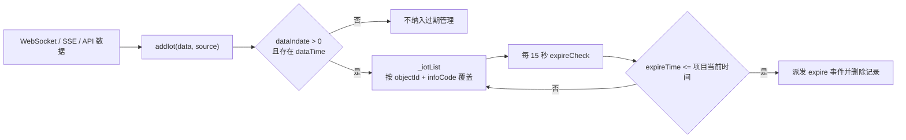

# IoT 信息点过期池数据流说明

## 范围与结论

本文说明根应用中 `src/utils/iotExpireManager.ts` 的 IoT 信息点过期管理机制，涵盖数据何时进入过期池、何时被判定为过期、不同数据通道的回调路径，以及它与 `DockSingleton` 的区别。

核心结论：

- `DockSingleton.setIotData(...)` 只负责写入全局响应式 IoT 数据池，**不会自动加入过期池**。
- 只有显式调用 `iotExpireManager.addIot(...)` 的信息点，才可能进入过期池。
- 信息点必须同时具有有效的 `dataIndate` 和 `dataTime`；否则被视为永久有效或无需前端托管过期状态。
- 同一 `objectId + infoCode` 在过期池中只有一条最新记录。
- 过期检查每 15 秒执行一次，因此实际过期通知最多可能晚约 15 秒。

## 核心对象

| 对象 | 文件 | 职责 |
| --- | --- | --- |
| `iotExpireManager` | `src/utils/iotExpireManager.ts` | 维护 `_iotList`，计算过期时间并派发 `expire` 事件。 |
| `DockSingleton` | `src/hooks/responsiveDock.js` | 维护页面读取的全局响应式 IoT / custom / 异常 / 风险数据。 |
| `DataDispatcher` | `src/utils/dataDispatcher/index.ts` | 在边缘端将 WebSocket 消息纳入过期管理，并向局部观察者重放过期消息。 |
| `SSEClient` | `src/utils/SSEClient.js` | 将 `IOT_DATA_CHANGE` SSE 推送纳入过期管理，并在过期时向自身事件回调重放空值。 |
| `http` | `src/utils/http.ts` | 将响应 `extra.expiringIots` 中的信息点纳入过期管理。 |

## 写入过期池的准入条件

所有入口最终都会调用：

```ts
iotExpireManager.addIot(iotData, source);
```

`addIot` 仅在以下条件都满足时写入 `_iotList`：

```ts
iotData.dataIndate && Number(iotData.dataIndate) > 0 && iotData.dataTime
```

字段含义：

| 字段 | 含义 |
| --- | --- |
| `objectId` | 对象实例 ID。 |
| `infoCode` | 信息点编码。与 `objectId` 共同组成过期池唯一键。 |
| `dataIndate` | 有效期，单位为分钟。必须是大于 0 的值。 |
| `dataTime` | 数据产生/更新时间，用于计算信息点真正的过期时刻。 |
| `from` | 写入来源，取值为 `WS`、`SSE` 或 `API`。 |

过期时刻的计算公式为：

$$
\text{expireTime} = \text{dayjs(dataTime)} + \text{dataIndate 分钟}
$$

同一 `objectId + infoCode` 的新记录会删除旧记录后写入，因此只保留最新有效期。

> `iotExpireManager.ts` 中声明的 `defaultDataIndate = 5` 当前没有被 `addIot` 使用。缺少 `dataIndate` 的信息点不会默认按 5 分钟过期，而是不会进入过期池。

## 数据入口

### 1. 边缘端 WebSocket

文件：`src/utils/dataDispatcher/index.ts`

`DataDispatcher.request(...)` 在边缘端收到 WebSocket 消息时执行：

```ts
const data = JSON.parse(event.data);
iotExpireManager.addIot(data, 'WS');
dataObserve.dispatch(data, this);
```

适用范围：使用 `dispatcher.request(globalSocket, httpCallback)` 的局部订阅逻辑，例如设备详情 `use-equipment.ts`。

### 2. SSE 的 `IOT_DATA_CHANGE`

文件：`src/utils/SSEClient.js`

`SSEClient` 构造时注册了 `IOT_DATA_CHANGE` 内部处理器：

```js
const iotDataChangeHandle = res => {
    if (res.data) {
        iotExpireManager?.addIot(res.data, 'SSE');
    }
};
```

因此，收到 `IOT_DATA_CHANGE` 的单条 SSE 信息点会尝试加入过期池。

注意：当前实现未对 `CLOUD_IOT_DATA_CHANGE` 注册同样的 `addIot` 内部处理器。云端批量推送即使被 `useResponsiveDockSSEHandle` 写入 `DockSingleton`，也不会仅因 `setIotData(...)` 自动进入过期池。

### 3. HTTP 通用响应字段

文件：`src/utils/http.ts`

所有通过该请求封装完成的请求，若响应具有以下结构：

```ts
{
    extra: {
        expiringIots: IotRecord[]
    }
}
```

则会遍历并写入：

```ts
iotExpireManager?.addIot(iot, 'API');
```

### 4. 运行监控批量查询接口

文件：`src/apis/monitor.js`

以下接口会显式将响应信息点按 `API` 来源写入过期池：

- `batchQueryInfoCodeConfig(...)`
- `batchQueryInfoCode(...)`

对应逻辑分别会补充 `objectId` 后调用：

```js
iotExpireManager?.addIot(iot, 'API');
```

### 5. 动态数据加载中的 `rcRunStatus`

文件：`src/hooks/dataDockHandling.js`

`loadBatchQueryInfoCodeIotHandling(...)` 在将结果写入 `DockSingleton` 后，会对 `rcRunStatus` 信息点额外执行：

```js
if (object.infoCode === 'rcRunStatus') {
    iotExpireManager?.addIot(object, 'API');
}
```

若同一信息点已通过其他 API 入口写入，后写入的记录会替换旧记录，不会产生重复的过期记录。

## 不会自动进入过期池的情况

以下调用不会触发 `addIot`：

```js
DockSingleton.getInstance().setIotData(objectId, infoCode, data);
```

例如关系图加载阶段，`src/components/RelationChart/hooks/useChartLoadOption.js` 会将下列信息点写入 `DockSingleton`：

- `fixedInfoCodes`
- `drawerAllInfoCodes`
- `panelNode.infoCodes`
- `textMap` 中带 `infoDetail` 的信息点

这些信息点可通过 `getIotData(objectId, infoCode)` 读取初始值，但不会仅因初始化写池而具备过期能力。

若需要让这类点位具备过期处理，必须由其后续 WebSocket、SSE 或 API 数据入口显式调用 `iotExpireManager.addIot(...)`，且数据满足 `dataIndate` 与 `dataTime` 的准入条件。

## 过期检查与通知

`IotExpireManager` 单例第一次创建时会启动检查定时器：

```ts
window.setInterval(() => {
    this.expireCheck();
}, 15000);
```

过期判定使用项目时区时间 `getDayjsTz()`：

```ts
if (iotRecord.expireTime <= currentProjectTime) {
    iotRecord.data.__expireSend__ = true;
    this.dispatchEvent('expire', iotRecord);
    this._iotList.splice(index, 1);
}
```

一条记录触发过期事件后立即从 `_iotList` 删除，因此同一条记录只会通知一次；收到后续新数据时才会重新进入过期池。



## 过期后的消费路径

### 边缘端设备详情：DataDispatcher → refreshEqFun

在 `src/views/operationMonitoring/components/info/use-equipment.ts` 中，边缘端会调用：

```ts
observe.response(data => {
    // 满足消息字段过滤条件时
    refreshEqFun(data);
});
```

而 `DataDispatcher.request(...)` 在边缘端注册过期事件：

```ts
iotExpireManager.addEventListener('expire', handleIotExpire);
```

收到过期记录后，`handleIotExpire` 会把原数据改造成空值状态，再通过同一 `DataObserve` 重放：

```ts
iotData.dataValue = undefined;
iotData.dataValueName = undefined;
iotData.invalid = 0;
dataObserve.dispatch(iotData, this);
```

对于 `WS` 来源，原有 `webType`、`type`、`dataStatus` 等字段会被保留。因此只要仍满足 `use-equipment.ts` 的过滤条件：

```ts
socketData.dataStatus === 1 &&
socketData.invalid === 0 &&
socketData.type === 0 &&
socketData.webType === 'PARAM_SET'
```

就会触发 `refreshEqFun(socketData)`，把设备抽屉内对应信息点更新为 `undefined`。

该局部过期监听仅在以下前提下有效：

- 当前为边缘端；
- 已调用 `observe.response(...)`；
- 组件未卸载；
- `observe.dispose()` 尚未移除 `expire` 监听。

### SSEClient：向 IOT_DATA_CHANGE 回调重放空值

每个 `SSEClient` 会监听全局 `expire` 事件。收到后，会向自身注册的 `IOT_DATA_CHANGE` 回调发送：

```js
{
    eventType: IOT_DATA_CHANGE,
    data: {
        ...expiredRecord,
        dataValue: '',
        dataValueName: ''
    }
}
```

随后页面的 `useResponsiveDockSSEHandle` 等处理逻辑可将空值写回 `DockSingleton`，使从 `getIotData(...)` 读取的 UI 显示无有效数据。

## 与 DockSingleton 的职责边界

| 能力 | `iotExpireManager` | `DockSingleton` |
| --- | --- | --- |
| 保存数据有效期记录 | 是 | 否 |
| 基于 `dataTime + dataIndate` 判断过期 | 是 | 否 |
| 派发过期事件 | 是 | 否 |
| 提供页面响应式最新 IoT 值 | 否 | 是 |
| `setIotData` 后自动托管有效期 | 不适用 | 否 |

推荐的数据流：

```text
初始化接口 / WebSocket / SSE
  → 必要时 addIot（过期管理）
  → setIotData（全局数据池）
  → 页面通过 getIotData 读取
  → 到期后派发空值数据
  → 消费侧回写或更新局部展示
```

## 排查清单

当某个信息点没有按预期变为空值时，按以下顺序检查：

1. 数据是否真的经过了 `addIot(...)`，而非只有 `setIotData(...)`。
2. 数据是否存在 `objectId`、`infoCode`、正数 `dataIndate` 与 `dataTime`。
3. `dataTime` 是否为可被 `dayjs(...)` 正确解析的时间值。
4. 同一 `objectId + infoCode` 是否被后续数据覆盖并延后了有效期。
5. 对应页面是否仍注册着 `expire` 监听，且未执行销毁/释放逻辑。
6. 局部消费方是否对过期重放数据有额外字段过滤，例如 `webType`、`type`、`dataStatus`。
7. 当前是否依赖 `CLOUD_IOT_DATA_CHANGE`；该事件在 `SSEClient` 内没有自动调用 `addIot(...)`。

## 已知实现注意点

- 过期池为全局单例，过期事件会广播给所有仍注册 `expire` 监听的消费者；消费方需要依据对象 ID、信息点编码和自身业务条件过滤。
- `SSEClient.destory()` 的释放逻辑会调用 `iotExpireManager.clear()`。由于过期池是全局单例，销毁任意一个 `SSEClient` 会清空当前所有待过期记录，可能影响其他仍存活的消费者。
- `DataDispatcher` 的过期事件监听只在边缘端 `request(...).response(...)` 时注册；云端 HTTP 轮询分支不会注册该局部监听。
