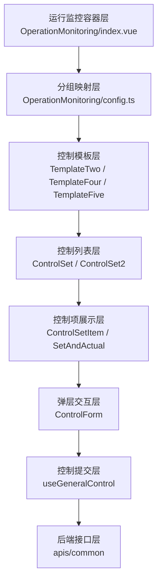
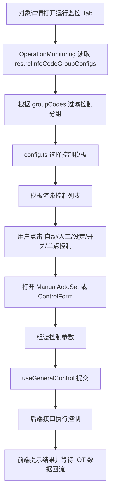
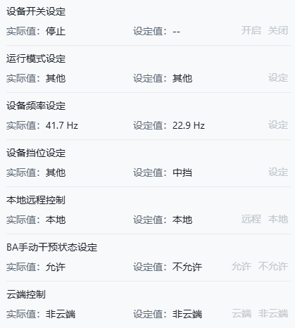
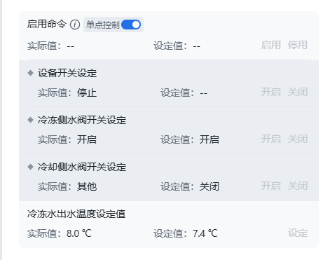
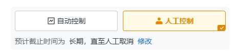
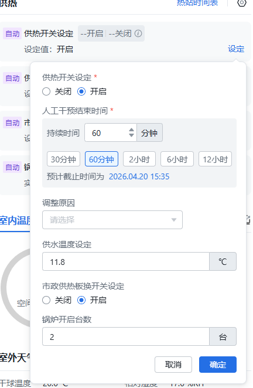

## 架构分层图

---

## 业务流程总览

---

## 控制流程分阶段说明

### 第一阶段：控制入口装配

**目标**

把对象详情中的控制类分组识别出来，并分发到对应模板。

**主要组件**

- `src/components/ObjectInfoComponents/OperationMonitoring/index.vue`
- `src/components/ObjectInfoComponents/OperationMonitoring/config.ts`

**这一阶段做了什么**

- 读取 `res.relInfoCodeGroupConfigs`
- 根据 `groupCodes` 过滤当前要展示的控制组
- 根据 `groupCode` 找到对应控制模板

- 容器层不直接做复杂控制交互，只负责“识别组、选模板、传上下文”
- 这样能保证不同设备/系统场景共用同一入口

---

### 第二阶段：控制模板承载

**目标**

根据控制复杂度选择不同模板承载控制区。

**主要组件**

- `TemplateTwo.vue`
- `TemplateFour.vue`
- `TemplateFive.vue`

**模板分工**

| 模板 | 适用场景 | 核心特征 |
|---|---|---|
| `TemplateTwo.vue` | 标准控制场景 | 直接承接 `ControlSet` |
| `TemplateFour.vue` | 增强控制场景 | 手自动 + `ControlSet2` + 单点控制 |
| `TemplateFive.vue` | 串联机组场景 | 串联机组说明 + 手自动 + `ControlSet2` |

- 模板层把“场景差异”隔离掉了
- 容器层不用关心具体控制布局，只负责分派到正确模板
- 特殊业务通过 `customControlComponent` 可以切换模板，而不必重写整块控制区

---

### 第三阶段：控制项列表渲染

**目标**

把控制参数渲染成可交互的控制项列表。

**主要组件**

- `ControlSet/index.vue`
- `ControlSet2/index.vue`
- `ControlSet/ControlSetItem.vue`
- `ControlSet2/ControlSetItem.vue`

**这一阶段做了什么**

- 过滤出 `IOT_SETTING` 类型信息点
- 根据场景决定是否展示单点控制、布尔按钮、子项展开
- 根据在线/远控等状态判断是否允许控制

---

### 第四阶段：行内交互与模式切换

**目标**

让用户能够直接在控制区进行操作，包括模式切换和参数设定。

**主要组件**

- `ManualAotoSet/index.vue`

  ​	
- `ControlSet/SetAndActual.vue`
- `ControlSet2/SetAndActual.vue`
- `SetButton.vue`
- `SetDiv.vue`

**对应交互**

- 自动模式 / 人工控制切换
- 单点控制开关
- 数值项点击“设定”
- 布尔项点击“开启 / 关闭”
- 查看实际值 / 设定值 / 干预截止时间

---

### 第五阶段：控制弹层与表单组装

**目标**

对用户操作进行确认、补充参数，并形成标准提交数据。

**主要组件**

- `ControlForm/index.vue`
- `ControlForm/config.js`
- `FormItemInfo.vue`
- `FormItemInputNumber.vue`
- `FormItemRadio.vue`
- `FormItemInterventionTime.vue`
- `FormItemInterventionTimeV2.vue`
- `FormReason.vue`

**这一阶段做了什么**

- 根据当前控制项动态生成表单
- 支持确认文案、数值输入、布尔选择、干预截止时间、调整原因等
- 统一由 `ControlForm` 承载弹层

---

### 第六阶段：控制提交与后端调用

**目标**

将前端组装好的控制数据统一提交到后端接口。

**主要组件 / Hook**

- `src/hooks/useGeneralControl.js`

**主要调用路径**

| 场景 | 提交方法 | 对应接口 |
|---|---|---|
| 手自动切换 / 普通控制 | `controlFn(...)` | `commandExecuteChangeManualAutoStatus` / `batchCommandSend` |
| 单对象批量控制 | `singleObjectBatchControlFn(...)` | `batchCommandSendBySingleObject` |

**汇报可讲要点**

- 提交能力通过 Hook 统一收口，避免散落在各个组件里
- 普通控制和批量控制使用不同通道，但对上层组件是统一抽象
- 提交完成后由 IOT 数据回流刷新界面状态

---

## 组件调用矩阵

| 阶段 | 职责 | 主要组件 |
|---|---|---|
| 入口装配 | 识别分组、分发模板 | `OperationMonitoring/index.vue`、`config.ts` |
| 模板承载 | 按场景装配控制区 | `TemplateTwo.vue`、`TemplateFour.vue`、`TemplateFive.vue` |
| 列表渲染 | 生成控制项列表 | `ControlSet`、`ControlSet2` |
| 行内交互 | 展示按钮、模式切换 | `ManualAotoSet`、`SetAndActual` |
| 弹层组装 | 统一控制表单 | `ControlForm` + `ControlForm/config.js` |
| 指令提交 | 控制下发 | `useGeneralControl.js` |
